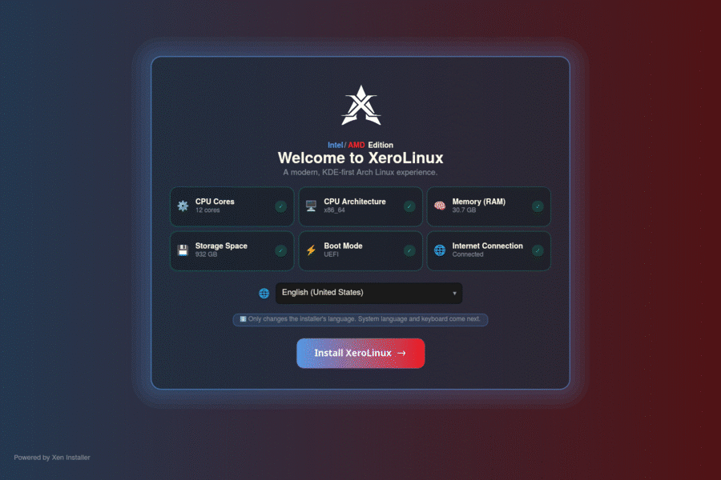

# Xen Installer

**Xen Installer** is the new **XeroLinux** graphical installer, built with Python/PySide6 on Qt6/QML. It walks a user through locale, user account, disk partitioning, optional software, and a review step, then installs the system as a background job pipeline while showing live progress. The GUI and the privileged installation engine run as separate processes talking over IPC, so the interface itself never needs root. Branding, colors, and copy come entirely from a per-distro YAML config, no code changes required. Used by XeroLinux, and adaptable to other Arch-based distros.

## License

GPL-3.0-or-later — see [LICENSE](LICENSE).

---

Inspired by [Omnis](https://framagit.org/gaming-linux-fr/glf-os/app-glf-os/omnis).
